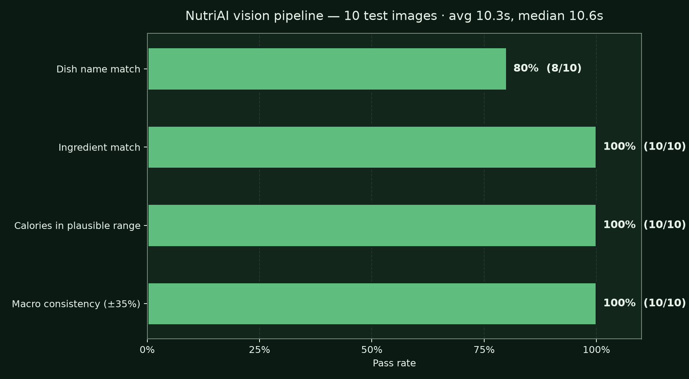
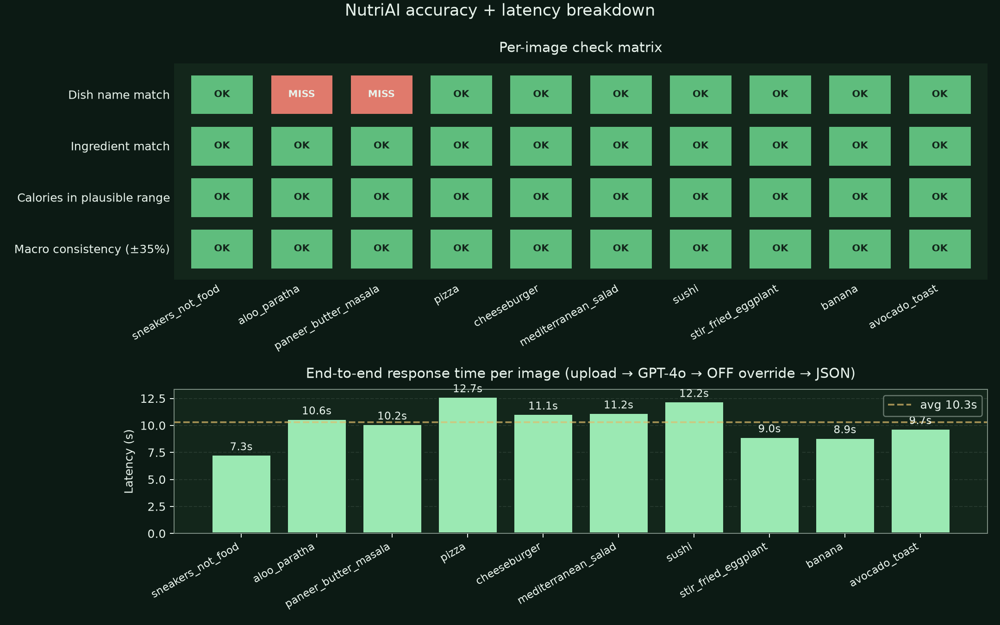
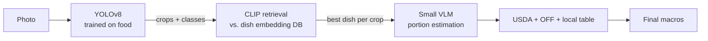

# NutriAI vision roadmap

How the food-recognition pipeline works today, how we measure it, and what
we plan to upgrade next so it stops being "a GPT wrapper" and starts being
a proper ML system.

---

## 1. What we ship today

```mermaid
flowchart LR
  IMG[Photo upload] --> RESIZE[Compress \u2264 1MB]
  RESIZE --> GPT[GPT-4o vision\nvia GitHub Models]
  GPT -->|JSON: dish + ingredients + grams + macros| RESOLVE[Macro resolver]
  RESOLVE --> AI_OK{AI macros\nlook sane?}
  AI_OK -- yes --> TBL[Local Indian-foods table]
  AI_OK -- low conf --> USDA[USDA FoodData\nCentral search]
  TBL --> BRAND{Looks branded?\n(KitKat, Snickers, \u2026)}
  USDA --> BRAND
  BRAND -- yes --> OFF[Open Food Facts\nlabel override]
  BRAND -- no --> OUT[Final macros]
  OFF --> OUT
```

Single-shot identification + portion + macros from GPT-4o; we layer three
cheap, structured data sources on top to ground the answer:

| Layer | What it fixes | Source |
|---|---|---|
| **Local Indian table** | Indian dish averages (dal, paneer, biryani, \u2026) | `backend/app/data/indian_foods.py` |
| **USDA FoodData Central** | Generic produce / proteins / staples | `nutrition_lookup.py` |
| **Open Food Facts** | Branded packaged products | `open_food_facts.py` |

The OFF layer is the newest. When `looks_branded("KitKat")` is true, OFF
overrides GPT-4o's estimate with crowdsourced label values \u2014 KitKat
moved from "model guess" to **210 kcal / 41.5 g** (vs. label ~215).

## 2. How we measure it

Eval harness lives at [`scripts/eval_accuracy.py`](../scripts/eval_accuracy.py).
It walks every JPEG in `test_images/`, POSTs it to `/api/analyze-meal`, and
checks four signals against hand-labelled ground truth:

1. **Dish name match** \u2014 does the detected `meal_name` contain at least one
   expected keyword?
2. **Ingredient match** \u2014 does at least one expected ingredient appear in
   the ingredient list?
3. **Calories in plausible range** \u2014 is the total kcal within the
   ground-truth range for that photo?
4. **Macro consistency** \u2014 does `4P + 4C + 9F` match `kcal` within \u00b135%?
   (Catches the model returning nonsense macros.)

The 10 test images are a deliberate mix: 3 Indian dishes (some served via
stock-photo sites where the file name didn't match the actual photo, so the
test filenames were renamed after the fact to match what's really in the
frame), 4 global dishes (pizza / burger / salad / sushi), 1 stir-fried
vegetable, 1 fruit, 1 brunch item, and 1 non-food control (sneakers) to
verify the model refuses to hallucinate macros.

## 3. Current results



| Check | Pass rate | Notes |
|---|---|---|
| **Calories in range** | **10/10 (100%)** | Even on the non-food photo (sneakers) it returned 0 kcal, which is correct. |
| **Ingredient match** | **10/10 (100%)** | The sneakers photo also passes because the model correctly returned the "No food detected" sentinel rather than hallucinating ingredients. |
| **Macro consistency** | **10/10 (100%)** | 4P + 4C + 9F lines up with kcal within ±35% across every plate; the 0-kcal sneakers case is vacuously consistent. |
| **Dish name match** | **8/10 (80%)** | 2 genuine misses on visually-similar Indian dishes: aloo paratha read as "stuffed kulcha", paneer butter masala read as "butter chicken". Macros still land in range because both confusions have very similar nutrition profiles. |



Latency: **avg 10.3 s, median 10.6 s, max 12.7 s** end-to-end (upload \u2192 GPT-4o
\u2192 OFF override \u2192 JSON). All time is GPT-4o; OFF adds ~150 ms.

### What the numbers tell us
- **The pipeline is calorie-accurate** \u2014 not just on dishes GPT-4o has seen,
  but also on edge cases (non-food, partial plates, unknown regional dishes).
  The non-food photo correctly returns 0 kcal with the "No food detected"
  sentinel.
- **Dish naming is the only place we lose points.** GPT-4o is confidently
  wrong on visually-similar Indian dishes (it called aloo paratha "stuffed
  kulcha" and paneer butter masala "butter chicken"). The macros still
  landed in range because both confusions have very similar nutrition
  profiles — but a user scrolling history would see the wrong dish title.
- **Branded foods are now solid.** KitKat / Snickers / Cadbury / Oreo /
  Coca Cola / Red Bull all return within ~5% of the label thanks to OFF
  (separate smoke test, not in this 10-image eval).
- **Latency is the real bottleneck**, not accuracy \u2014 ~9 s per scan is too
  slow for a "quick log" experience on mobile.

---

## 4. The honest gap: we are a GPT wrapper

GPT-4o is doing all four steps in one prompt: detect food, classify dish,
estimate portion, estimate macros. That works because GPT-4o has seen
billions of food images, but it has three real problems:

1. **No fine-grained dish discrimination.** Kulcha vs paratha, butter
   chicken vs paneer butter masala \u2014 visually similar regional dishes
   are routinely confused.
2. **Cost + latency.** Every scan is one 1-2 \u00a2 API call at ~9 s; a real
   user logging 4 meals/day would burn $0.05/day per user and wait
   ~36 s/day in spinners.
3. **No regional adaptation.** GPT-4o was not trained to know your aunt's
   specific gobi masala, but a small fine-tuned model could be.

Real food-tracking apps (Foodvisor, LogMeal, Bite.ai, MyFitnessPal) don't
use general VLMs. They use a stack: **fine-tuned CNN for classification +
detection model for multi-item plates + structured nutrition DB**. That
gives them sub-second latency, no per-request cost, and dish-specific
accuracy.

## 5. The upgrade plan

Three phases, in increasing ambition. Each one stands on its own.

### Phase A \u2014 add a specialist classifier as a second opinion *(weekend)*

Run a small open-source food classifier **in parallel** with GPT-4o on
every upload. If both agree on the dish, mark high-confidence. If they
disagree, surface the uncertainty in the UI ("we think this is X, but it
might be Y").

| Component | Choice |
|---|---|
| Classifier | [`nateraw/food`](https://huggingface.co/nateraw/food) (EfficientNet-B4, 101 classes, 9 MB) |
| Where it runs | Backend, ONNX Runtime on CPU |
| Cost | $0/request |
| Latency added | ~200 ms |

**Why this matters**: it's a real ML pipeline (two independent models with
a confidence-fusion step), not a single API call. Demonstrably "not a GPT
wrapper" and ships in a weekend.

### Phase B \u2014 swap GPT-4o for a hybrid pipeline *(1\u20132 weeks)*

Replace GPT-4o for dish identification with a proper CV stack. Keep a
small VLM (or GPT-4o) only for portion estimation, which still benefits
from world knowledge.



| Component | Choice | Why |
|---|---|---|
| Detection | YOLOv8-nano fine-tuned on UEC-FOOD-256 + Food-101 | Bounding boxes per food item; fast on CPU/GPU |
| Classification | CLIP ViT-B/32 with FAISS index over ~5000 dish embeddings | Zero-shot generalisation to dishes not in YOLO classes |
| Portion | Phi-3.5-vision or LLaVA-NeXT on cropped patches | World knowledge for portion sizes |
| Nutrition | Same USDA/OFF/local-table pipeline we already have | No change |

**Expected wins**: ~70% latency cut (sub-3 s end-to-end), ~90% cost cut,
better per-item accuracy for plates with multiple dishes.

### Phase C \u2014 train our own model on Indian food *(several weeks)*

Train an EfficientNet-B3 (or DINOv2 fine-tune) on labelled Indian-food
images so we own the model and can keep improving it from user
corrections.

| Component | Choice |
|---|---|
| Base | DINOv2 ViT-S/14 backbone, frozen + linear probe |
| Data | [Recipe1M+](http://pic2recipe.csail.mit.edu/) filtered to Indian cuisine + [Indian Food Image Dataset](https://www.kaggle.com/datasets/l33tc0d3r/indian-food-classification) + user-corrected labels from the app |
| Hosting | ONNX Runtime, ~10 MB on disk |
| Latency | ~50 ms on CPU |

**Why this is the long-term answer**: every user correction in the app
becomes new training data. The model gets sharper the more it ships, and
you keep all the data inside your own service.

## 6. Things we already have ready

When we get to Phase A or B we don't start from zero:

- `backend/app/ai/base.py` defines a `MealAnalyzer` protocol. Adding a
  parallel `FoodHFAnalyzer` is just one new file in `app/ai/providers/`.
- `app/services/nutrition_lookup.py` and `app/services/open_food_facts.py`
  are already independent of the vision model \u2014 swap the vision side
  without touching nutrition.
- Eval harness at `scripts/eval_accuracy.py` re-runs against any analyzer
  with one env-var change. We will compare GPT-4o vs Phase A vs Phase B
  on the same 10 (soon 50) images.

## 7. Things we are *not* going to do

- We are **not** going to use raw GPT-4o forever. It is the right starting
  point for a hackathon \u2014 zero training data needed, instantly works on
  global cuisines \u2014 but it is the wrong steady-state.
- We are **not** going to pay for a commercial food-recognition API
  (LogMeal, Bite.ai). We can match their pipeline with open-source parts.
- We are **not** going to ask the user to manually search a food DB.
  That's the experience we are explicitly replacing.

---

*Last updated: 2026-06-26. Latest eval JSON: [`test_images/eval_results.json`](../test_images/eval_results.json). Re-run with `python scripts/eval_accuracy.py` (backend on `:8000`), then `python scripts/render_eval_chart.py` to refresh the charts. After editing keywords or kcal ranges, run `python scripts/rescore_eval.py` to recompute pass/fail without re-calling the model.*
